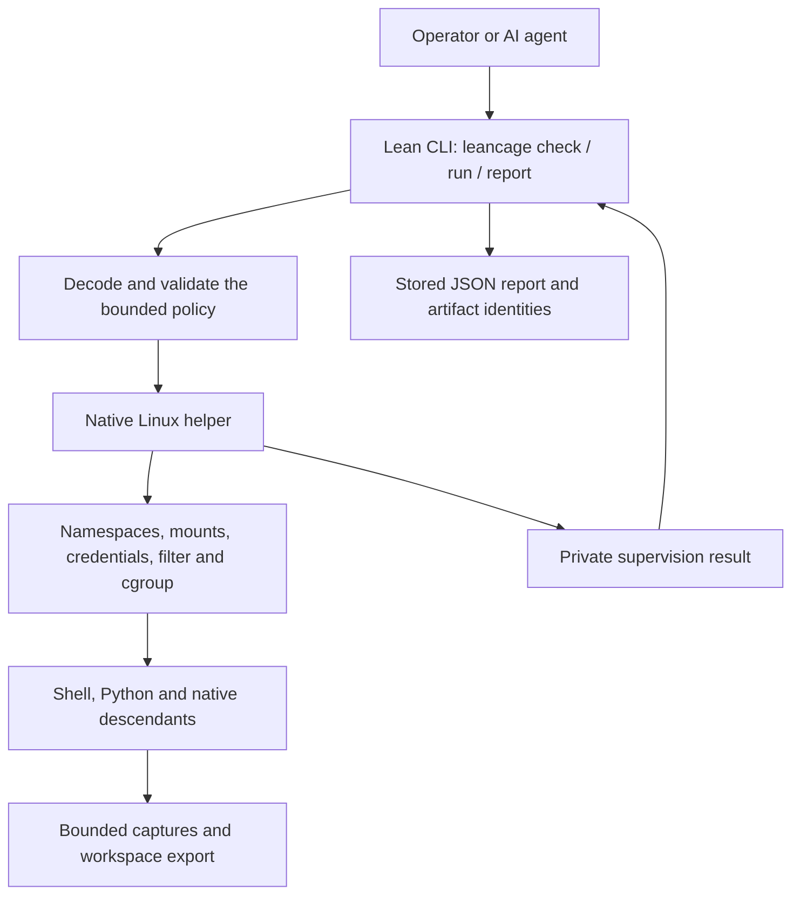

# AR-product: One runnable product and a composed assurance chain

Implement the reusable interface in [§FS-compatibility.interface](../functional-spec/FS-compatibility.md#interface-versioned-commands) and the release
boundary in [§FS-assurance.closure](../functional-spec/FS-assurance.md#closure-rules-for-stronger-claims) as one maintained execution path for each
supported deployment profile. The milestones organize development and evidence;
they are not seven applications that a caller must assemble. The current Linux
integration point is `m3/Main.lean`, which builds the executable `leancage`.

## execution: Current path from policy to workload and report

The existing path implements [§FS-workspace.policy](../functional-spec/FS-workspace.md#policy-bounded-typed-request) and [§FS-workspace.results](../functional-spec/FS-workspace.md#results-entry-cancellation-and-bounded-transport):

`LeanCageM3.API` prepares the policy plan, starts `/leancage-m3-helper`, decodes
its private result and stores the report. Guest output is captured separately.
The helper establishes the Linux environment, executes and supervises the guest,
and reports observed termination and cleanup. The mechanism and failure map is
[§AR-workspace.filesystem](AR-workspace.md#filesystem-linux-construction-and-handle-discipline), [§AR-workspace.transport](AR-workspace.md#transport-private-events-and-public-result) and [§AR-workspace.resources](AR-workspace.md#resources-concrete-accounting-boundary).
Conditional model claims and native test evidence are distinct in
[§FS-assurance.workspace](../functional-spec/FS-assurance.md#workspace-m3-workspace-model-and-vm-evidence); this diagram does not close their correspondence gap.

The current profile runs only inside its designated disposable VM. The harness
installs the controller as `/leancage`, calls all three public commands, executes
real workloads and powers off. [Running LeanCage](../running.md) documents the
existing build and replay commands. A host-side arbitrary-policy VM launcher is
an integration task below, not an existing interface.

## milestones: How the pieces compose

| Work | Role in the maintained product | Required connection |
|---|---|---|
| M1 | Decoder, filter and launch foundations; preserved regression profile | Exact byte/ABI and launch claims at their stated boundaries |
| M2 | Lifecycle, ownership, setup order and descendant foundations | The M3 successful receipt sequence projects to the M2 plan |
| M3 | Current runnable policy/controller/helper/runtime/report path | Model composition plus native VM workflows; correspondence remains conditional |
| M4 | Connect the live implementation, Linux effects and executable artifacts to the models | Checked source/semantics/Lean connections and a composed profile argument |
| M5 | Extend the profile's observation and enforcement argument to hardware channels | A stated leakage property connected to the same executable/platform profile |
| M6 | Optional alternative backend behind the portable contracts | A separate backend refinement; no dependency for the Linux release |
| M7 | Package and support the integrated implementation and its completed advertised guarantees | Identified executable, runtime/kernel/platform, evidence and operating procedure |

The dependent Lake packages preserve useful earlier interfaces and proofs. M3
invokes its own helper directly; it does not launch the M1 and M2 demonstration
executables in sequence. M3's versioned policy/filter and dynamic runtime have
their own claims; neither the fixed M1 filter nor M2's static image contract
automatically establishes those claims. The projection and limits are recorded
in [§FS-assurance.workspace](../functional-spec/FS-assurance.md#workspace-m3-workspace-model-and-vm-evidence) and the [M3 handoff](../reviews/M3-handoff.md).

M4 proof tools are development/review tools. Workload execution follows the
controller/helper/Linux path; it does not invoke Rocq or proof search for each
guest command. Any extraction or proof in another assistant still needs the
checked connection required by [§AR-verification.composition](AR-verification.md#composition-proof-obligations-at-boundaries). The final chain must
refer to the actual maintained implementation and advertised observations.

## integration: Maintain a vertical execution path during the proof work

Keep a runnable integration track alongside [§RM-roadmap.m4.packages](../roadmap.md#m4packages-correspondence-work-after-the-reviewed-m3-baseline), rather than
deferring assembly until M7. It implements the existing interface and profile
contracts, without changing the scope of the assigned native proof package.
Assign these bounded tasks explicitly before implementing them:

1. **Build entry point.** Provide one documented project-root build command for
   the public controller, native helper and profile manifests. Preserve the M1/M2
   packages as regression baselines. The current build command is documented in
   [the running guide](../running.md); a new root build wrapper is still planned.
2. **Policy-driven VM entry point.** Extend the development experience beyond
   fixed acceptance cases: accept a reviewed policy and bounded input snapshots,
   execute through the same public CLI in the disposable VM, and return its typed
   report, stdout/stderr and export artifacts. Specify VM transport, ownership,
   byte limits and report loss before implementation. Guest bytes must never be
   host commands or control messages; preserve [§FS-workspace.results](../functional-spec/FS-workspace.md#results-entry-cancellation-and-bounded-transport).
3. **One profile bundle.** Stage the controller, helper, filter, locked runtime,
   kernel/configuration, input preparation rules and assurance manifest through
   one recipe. Identify all dependencies and preserve licensing. A bundle's
   hashes identify it; the assurance record states what is proved and assumed.
4. **Public-path regression.** Exercise one useful Python workflow and one shell
   workflow through `check`, `run` and `report`, including allowed file creation,
   denied effects, cancellation, bounded output and cleanup. Verify report and
   exported bytes against the invocation, using the binaries from that bundle.
   The existing API checks are the baseline; arbitrary-policy transport and a
   packaged workflow need their own tests and supported-profile evidence.
5. **Composition review.** For every runtime or proof change, identify which live
   function/artifact and model edge it affects, preserve the public-path checks
   and review any changed profile or evidence identity. M4/M5 completion requires
   the applicable composed property, not a collection of unrelated passing lemmas.

All five tasks are planned integration work; this document supplies their scope,
not implementation or new security evidence. The existing M3 executable and its
VM acceptance suite remain the runnable baseline. Version any later relocation
or refactor of that implementation and keep the proof input connected to it.

## organization: Organize the maintained product by responsibility

The maintained product must be understandable from its functionality. New source
packages, namespaces, binaries, scripts and tests use responsibility-based names.
Milestone labels remain useful in the roadmap and archived evidence. The current
`m2/`, `m3/`, `m4/`, `LeanCageM*` and milestone-named native/script paths are
temporary organization, with consolidation scheduled at the next stable
integration point after the active M4 run. Do not rename files underneath it.

Consolidation has concrete acceptance criteria:

1. Map existing code into portable policy/lifecycle/workspace libraries, the
   public CLI, Linux bindings, and verification components organized by the code
   and semantics they verify. Reuse implementations and define their imports;
   moving the same parallel copies into new folders is insufficient.
2. Provide documented project-root build and run/check/report entry points. A
   caller must not need milestone history or know which numbered directory to
   enter. Keep demonstration/regression profiles separate from the product path.
3. Update imports, build recipes, scripts, CI, examples and documentation together.
   Preserve real versioned contracts; use temporary compatibility entry points
   where existing consumers need them. Record the old-to-new mapping once.
4. Keep archived proof inputs and receipts reproducible at their recorded
   revisions. Map current evidence to the relocated live implementation and
   check preserved statements, assumptions and artifact correspondence once.
5. Make validation depend on actual component inputs. Separate operational prose
   fingerprints from proof/build dependencies while retaining dependencies on
   contracts and assurance claims. Routine agent-guidance edits must have a
   lightweight integrity check. Deduplicate aggregate/prerequisite work using
   matching-input results under [§AR-tooling.checks](AR-tooling.md#checks-one-development-gate).

The migration is done when a newcomer can build and exercise the supported
`leancage` workflow from the root, locate its implementation by responsibility,
and replay the affected assurance checks without selecting a milestone package.
Keep the supported execution environment and public behavior intact throughout.

## release: Deployment is an explicit final boundary

M7 delivers an installable documented interface for supported Linux profiles under
[§FS-assurance.closure](../functional-spec/FS-assurance.md#closure-rules-for-stronger-claims). Review the actual host prerequisites, privileges, kernel,
runtime, persistent report/export storage, failed-run quarantine/recovery, update
procedure and hardware assumptions before broadening the current VM-only profile.
Removing a VM marker check alone cannot establish deployment support or security.
The installed product may contain a controller, helper and runtime dependencies;
the caller uses the single versioned `leancage` interface.

M4/M5 results and any changed enforcement mechanisms must be connected to that
same release bundle. Unsupported profiles fail explicitly. Hardware observation
claims remain [§FS-observations.hardware](../functional-spec/FS-observations.md#hardware-software-observable-channels) obligations until their exact chain is
proved and reviewed.
